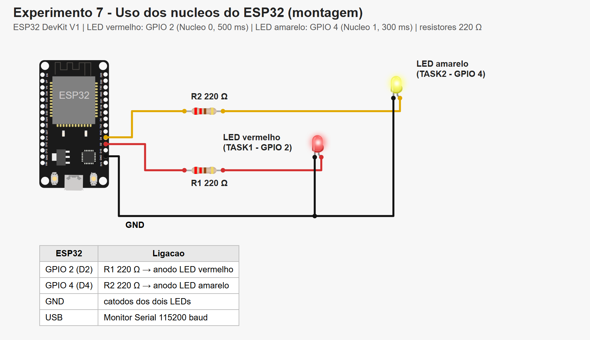

# Experimento 7 – Uso dos núcleos do ESP32

**Objetivos:** utilizar a função `xTaskCreatePinnedToCore()` e comparar uma aplicação com RTOS (FreeRTOS) e sem RTOS (loop sequencial).

## Estrutura

| Pasta | Conteúdo |
|---|---|
| `projeto_01_pinned_to_core/` | Roteiro "Experimento 3": LED vermelho (núcleo 0, 500 ms) e amarelo (núcleo 1, 300 ms) com `xTaskCreatePinnedToCore` |
| `projeto_02_com_rtos/` | Roteiro "Experimento 4 – Versão 1": dois LEDs, uma tarefa por núcleo, medindo o intervalo com `esp_timer_get_time()` |
| `projeto_03_sem_rtos/` | Roteiro "Experimento 4 – Versão 2": mesmo comportamento em um único `loop()` com `millis()` |
| `atividade_avaliativa_01/` | Monitoramento temporal (instante de ativação, núcleo, período esperado × observado, desvio, jitter e resumo estatístico) |
| `atividade_avaliativa_02_com_rtos/` | Versão com FreeRTOS + estatísticas (mín., máx., média, desvio padrão, jitter pico a pico) |
| `atividade_avaliativa_02_sem_rtos/` | Versão sequencial + as mesmas estatísticas, para comparar diretamente |
| `montagem/` | `diagram.json` (Wokwi), imagem da montagem e o HTML usado para gerar a imagem |

## Montagem



| ESP32 | Ligação |
|---|---|
| GPIO 2 (D2) | resistor de 220 Ω → anodo do LED vermelho |
| GPIO 4 (D4) | resistor de 220 Ω → anodo do LED amarelo |
| GND | catodos dos dois LEDs |

> O Tinkercad não tem ESP32 (só Arduino/micro:bit) e não roda FreeRTOS com dois núcleos. Por isso a simulação foi feita no **Wokwi**, que simula o ESP32 com FreeRTOS.
> Para simular: em <https://wokwi.com/projects/new/esp32>, cole o código `.ino` na aba `sketch.ino` e o conteúdo de `montagem/diagram.json` na aba `diagram.json`. Todos os projetos usam o mesmo circuito.

Todos os sketches usam **115200 baud** no Monitor Serial.

---

## Atividade Avaliativa 1 – passo a passo do código

1. **Configurações** (`#define`): pinos (2 e 4), períodos (500 e 300 ms), `RESUMO_A_CADA` (a cada quantas execuções o resumo estatístico é impresso) e `USAR_DELAY_UNTIL` (0 = `vTaskDelay`, como no experimento original; 1 = `vTaskDelayUntil`).
2. **`struct MonitorTarefa`**: guarda os dados de cada tarefa: nome, pino, período, instante da ativação anterior, intervalo anterior, contadores e acumuladores (mínimo, máximo, soma e soma dos quadrados).
3. **`setup()`**: inicia a Serial, configura os LEDs e cria um **mutex** (`xSemaphoreCreateMutex`) para a Serial. Sem o mutex, as duas tarefas, rodando ao mesmo tempo em núcleos diferentes, misturam caracteres no monitor. Depois cria as tarefas com `xTaskCreatePinnedToCore`: TASK1 → núcleo 0, prioridade 1; TASK2 → núcleo 1, prioridade 2. O ponteiro da estrutura de monitoramento vai em `pvParameters`.
4. **Tarefas `blinkVermelho` / `blinkAmarelo`**: a cada ciclo
   - leem o instante de ativação com `esp_timer_get_time()` (µs) **antes** de qualquer processamento, para que o tempo de impressão não distorça a medida;
   - invertem o LED;
   - chamam `registrarAtivacao()`;
   - esperam o próximo período (`vTaskDelay` ou `vTaskDelayUntil`).
5. **`registrarAtivacao()`**:
   - na 1ª ativação só guarda o instante;
   - depois calcula **intervalo observado** = agora − anterior, **desvio** = observado − esperado e **jitter ciclo a ciclo** = |Tₖ − Tₖ₋₁|;
   - atualiza mínimo, máximo, soma e soma dos quadrados;
   - com o mutex, imprime: `[tempo s] TAREFA | Nucleo | Esperado | Observado | Desvio | Jitter`;
   - a cada `RESUMO_A_CADA` execuções imprime o **resumo**: mínimo, máximo, média, desvio padrão, **jitter pico a pico** (máx − mín), pior atraso e se o período foi respeitado (variação ≤ 1 ms = 1 tick).

Exemplo de saída:
```
[  3.512034 s] TASK1 LED VERMELHO | Nucleo 0 | Esperado: 500000 us | Observado: 501987 us | Desvio: +1987 us | Jitter: 12 us
[  3.613870 s] TASK2 LED AMARELO  | Nucleo 1 | Esperado: 300000 us | Observado: 301010 us | Desvio: +1010 us | Jitter: 3 us
--------------------------------------------------------------------------
RESUMO TASK2 LED AMARELO  | Nucleo 1 | ultimas 20 execucoes (total 21)
  Esperado: 300000 us | Min: 300990 us | Max: 301050 us | Media: 301012.4 us
  Desvio padrao: 14.2 us | Jitter pico-a-pico: 60 us | Pior atraso: +1050 us
```

**O que analisar:** com `vTaskDelay` o período real é *tempo de execução da tarefa (incluindo o `printf`) + atraso*, além do arredondamento para o tick de 1 ms. Por isso aparece um atraso fixo de cerca de 1 a 2 ms e uma **deriva acumulada**. Com `USAR_DELAY_UNTIL 1`, a tarefa acorda em instantes absolutos múltiplos do período: o desvio médio cai para perto de 0 e sobra só o jitter de escalonamento e da Serial (dezenas de µs). Teste os dois modos e coloque no relatório.

---

## Atividade Avaliativa 2 – comparação com e sem RTOS

Os dois sketches imprimem no **mesmo formato** (`COM RTOS | ...` / `SEM RTOS | ...` e `>> RESUMO ...`), então dá para montar uma tabela direto com os valores de *Min / Max / Média / DP / Jitter p-p*.

`CARGA_MS` simula um processamento bloqueante (por exemplo, a leitura de um sensor) que se repete a cada `PERIODO_CARGA_MS`:
- **Sem RTOS**: a carga roda dentro do `loop()` e, enquanto ela executa, nenhum LED é atendido.
- **Com RTOS**: a carga é uma tarefa separada no núcleo 1, e o escalonador intercala as tarefas.

Roteiro sugerido: rode as duas versões com `CARGA_MS 0`, depois com `CARGA_MS 50`, e compare os resumos.

### Rascunho de respostas (confira com os seus dados medidos)

1. **Regularidade:** sem carga, as duas são regulares. A versão sequencial pode até parecer perfeita em ms, porque `millis()` esconde variações abaixo de 1 ms. Com carga, a versão com RTOS fica bem mais regular, porque cada LED é uma tarefa independente e o atraso de uma não se propaga para a outra.
2. **Maior jitter:** a versão **sem RTOS**, principalmente com carga ou quando os dois LEDs vencem no mesmo instante (múltiplos de 1500 ms): um `Serial.printf` bloqueia o loop e atrasa o outro LED. Com carga de 50 ms, o jitter da versão sequencial chega a dezenas de ms; na versão com RTOS fica em torno de 1 tick.
3. **Dois núcleos:** sim. Cada LED tem seu próprio núcleo, então as tarefas não disputam CPU e o atraso de uma não afeta a outra. O ganho é pequeno sem carga e grande com carga. O recurso compartilhado que sobra é a **Serial**, protegida por mutex.
4. **O RTOS garante menor jitter?** **Não necessariamente.** O RTOS dá ferramentas (prioridades, preempção, `vTaskDelayUntil`, afinidade de núcleo), mas o resultado depende do uso: `vTaskDelay` acumula deriva, a resolução é de 1 tick (1 ms), recursos compartilhados (Serial, mutex) causam bloqueio e inversão de prioridade, interrupções e tarefas de maior prioridade introduzem atrasos, e há overhead de troca de contexto. Um loop sequencial simples e sem bloqueios pode ter jitter tão baixo quanto um RTOS. O RTOS facilita cumprir requisitos temporais e torna o sistema previsível, mas a garantia vem do projeto: análise de escalonabilidade, prioridades corretas e esperas absolutas.

---

## Problemas previstos e decisões de implementação

> Use como base para a seção de histórico do relatório, acrescentando os erros que vocês encontrarem de fato ao testar.

- **Mensagens misturadas na Serial:** as duas tarefas rodam em paralelo de verdade (dois núcleos) e os `printf` se intercalavam. Solução: um mutex (`SemaphoreHandle_t`) em volta da impressão.
- **Medida distorcida:** no início o tempo era lido depois do `printf`, e a duração da transmissão serial entrava no intervalo. Solução: ler `esp_timer_get_time()` logo no início do ciclo.
- **Intervalo sempre maior que o esperado:** com `vTaskDelay`, o período vira execução + atraso. Solução: opção `USAR_DELAY_UNTIL` com `vTaskDelayUntil`.
- **Resolução de `millis()`:** na versão sem RTOS do roteiro, `millis()` não mostra o jitter abaixo de 1 ms. Na atividade 2 a medida foi trocada por `micros()`.
